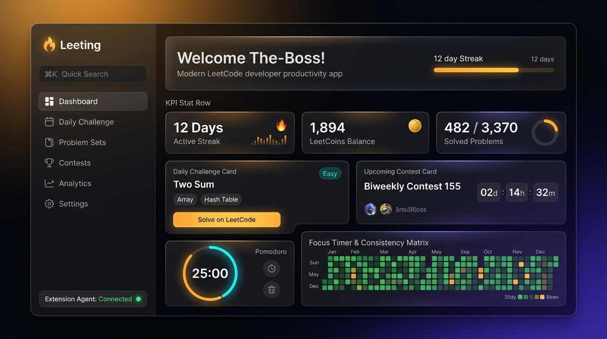
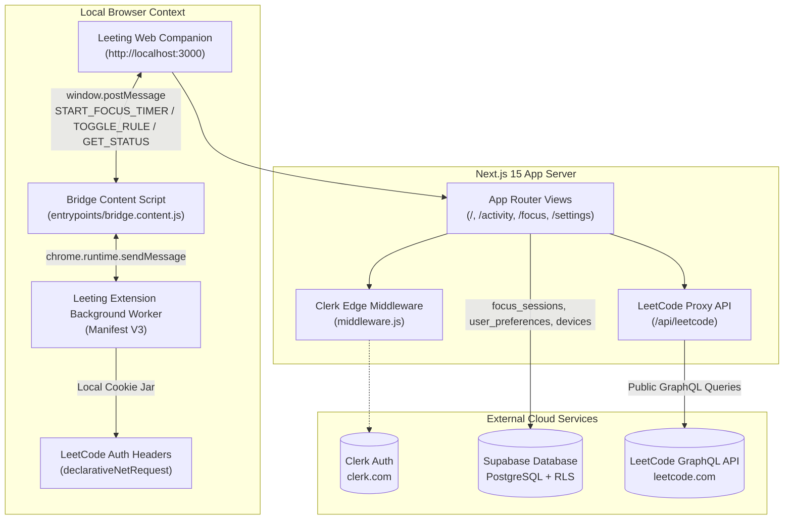

# Leeting Web — Desktop Companion & Remote Controller

A modern, high-performance web dashboard and remote controller for the **[Leeting Browser Extension](https://github.com/anirban-moi/leeting)**. Built with **Next.js 15 (App Router)**, **Tailwind CSS**, **Clerk Authentication**, and **Supabase (PostgreSQL)**, featuring a bespoke **Obsidian Glassmorphism** design system.

Leeting Web provides a desktop command center to visualize your 365-day LeetCode algorithmic consistency, sync Pomodoro focus sessions across browser tabs, and remotely manage distraction shielding rules.

---

## Screenshots

| 365-Day Consistency Heatmap (Month Block Sections) | Obsidian Glassmorphism Welcome & Streak Hub |
| :---: | :---: |
|  |  |

### Desktop Command Center Overview


---

## Architecture

Leeting Web is designed with a **privacy-first zero-knowledge architecture**: sensitive LeetCode authentication cookies never leave your browser extension's local cookie jar. The companion web application communicates via a local message bridge and stores non-sensitive preferences and session telemetry in Supabase.



---

## Key Features

### 1. Hybrid Obsidian Glassmorphism Dashboard (`/`)
- **Adaptive Welcome Card**: Displays greeting, active streak, and profile badge positioned cleanly with maximum horizontal breathing room.
- **Live Device Sync Pill**: Auto-detects running browser extension instances (`Chrome`, `Edge`, `Firefox`) and indicates live connection state.
- **Real-Time LeetCode Metrics**: Tracks Current Streak, LeetCoin balance, and Problems Solved categorized by difficulty (*Easy*, *Medium*, *Hard*).
- **Daily Challenge Card**: Shows today's problem name, difficulty level, topic tags, and direct solve link.
- **Upcoming Contest Countdown**: Displays countdown timer for the next LeetCode contest with 45-minute alert indicators.

### 2. 365-Day Consistency Matrix (`/activity`)
- **Discrete Month Block Sections**: Activity grid is segmented into 12–13 clear month containers separated by glass divider lines.
- **Centered Month Headers**: Clean, border-free month labels centered over their respective calendar weeks.
- **Pinned Day Labels**: Left-hand `MON`, `WED`, `FRI` labels remain anchored outside the horizontal scroll container so they never scroll out of view.
- **Zero-Shift Activity Inspector**: Fixed inspection bar showing exact problem counts on hover or click, explicitly rendering `0 problems solved` on inactive days for uniform layout stability.
- **Multi-Range Filtering**: Switch between 35-Day, Annual 2026, and Rolling 365-Day views.

### 3. Focus & Shield Remote Controller (`/focus`)
- **Interactive Circular Pomodoro Timer**: Preset durations (`25m`, `45m`, `60m`, `90m`) with visual SVG progress ring.
- **Bi-Directional Extension Sync**: Starting or pausing the timer on the web sends `START_FOCUS_TIMER` / `STOP_FOCUS_TIMER` messages to the browser extension to enforce distraction blocking in real time.
- **Focus Rewards**: Awards Focus Coins (+25 for standard session, +50 for deep focus) upon completion.
- **Cloud Focus Session History**: Automatically logs completed sessions to Supabase PostgreSQL (with automatic local storage fallback when offline).
- **Remote Distraction Toggles**: Control YouTube Shorts, YouTube Playables, Instagram, Facebook, and LinkedIn Video blocking directly from the desktop.

### 4. Settings & Device Registry (`/settings`)
- **Multi-Instance Device Registry**: Monitors registered extension heartbeats across browsers.
- **Notification Preferences & Quiet Hours**: Configure quiet hours schedules and alert toggles.
- **Cloud Sync Health**: Status indicators for Clerk session and Supabase PostgreSQL connection.

---

## Directory Structure

```text
leeting_web/
├── app/
│   ├── layout.jsx            # Root HTML layout with Obsidian Glass Sidebar and Header
│   ├── page.jsx              # Home Dashboard overview
│   ├── activity/
│   │   └── page.jsx          # 365-Day Consistency Matrix & Activity Hub
│   ├── focus/
│   │   └── page.jsx          # Pomodoro timer, remote shielding & session history
│   ├── settings/
│   │   └── page.jsx          # Device registry, quiet hours & notifications
│   ├── api/
│   │   └── leetcode/
│   │       └── route.js      # Server-side proxy for LeetCode public GraphQL
│   └── globals.css           # Tailwind base styles and Obsidian Glass tokens
├── components/
│   ├── layout/
│   │   ├── Sidebar.jsx       # Navigation sidebar with collapsible mobile support
│   │   └── Header.jsx        # Top identity bar and live extension sync pill
│   ├── cards/
│   │   ├── StatCard.jsx      # Reusable KPI metric card
│   │   ├── ChallengeCard.jsx # Daily challenge preview & action card
│   │   └── ContestCard.jsx   # Upcoming contest countdown card
│   └── focus/
│       ├── FocusTimer.jsx    # Circular countdown timer widget with extension bridge
│       └── RuleToggle.jsx    # Remote distraction shield toggle switch
├── lib/
│   ├── services/
│   │   ├── device-service.js     # Device heartbeat & extension registry
│   │   ├── extension-bridge.js   # window.postMessage bridge to Leeting extension
│   │   ├── focus-service.js      # Focus session logging & history fetching
│   │   ├── preferences-service.js # User preferences & quiet hours sync
│   │   └── profile-service.js    # LeetCode profile data caching
│   ├── supabase/
│   │   ├── client.js             # Browser Supabase client
│   │   ├── server.js             # Server-side SSR Supabase client
│   │   └── schema_clerk.sql      # PostgreSQL schema with Row-Level Security
│   ├── mock-data.js          # Resilient fallback state for offline / unauthenticated mode
│   └── utils.js              # Date, countdown, and class formatting helpers
├── public/
│   └── screenshots/          # High-resolution application screenshots
├── tests/
│   ├── auth.test.mjs         # Authentication & profile fallback test suite
│   ├── bridge.test.mjs       # Extension bridge & device registry test suite
│   ├── focus.test.mjs        # Focus timer & cloud logging test suite
│   ├── leetcode-api.test.mjs # LeetCode data schema validation test suite
│   └── preferences.test.mjs  # User preferences sync test suite
├── .env.example              # Environment variable documentation template
├── middleware.js             # Clerk edge authentication middleware
├── package.json
├── tailwind.config.js
└── next.config.mjs
```

---

## Getting Started

### Prerequisites
- **Node.js**: v20 or later
- **pnpm** (recommended) or **npm**

### 1. Installation

```bash
# Clone the repository
git clone https://github.com/anirban-moi/leeting_web.git
cd leeting_web

# Install dependencies
pnpm install
```

### 2. Configure Environment Variables

Copy `.env.example` to `.env.local`:

```bash
cp .env.example .env.local
```

Fill in your Clerk and Supabase credentials in `.env.local`:

```env
# Clerk Authentication (https://dashboard.clerk.com)
NEXT_PUBLIC_CLERK_PUBLISHABLE_KEY=pk_test_...
CLERK_SECRET_KEY=sk_test_...

NEXT_PUBLIC_CLERK_SIGN_IN_URL=/sign-in
NEXT_PUBLIC_CLERK_SIGN_UP_URL=/sign-up
NEXT_PUBLIC_CLERK_AFTER_SIGN_IN_URL=/
NEXT_PUBLIC_CLERK_AFTER_SIGN_UP_URL=/

# Supabase PostgreSQL (https://supabase.com)
NEXT_PUBLIC_SUPABASE_URL=https://your-project-id.supabase.co
NEXT_PUBLIC_SUPABASE_ANON_KEY=sb_publishable_...
```

*(Note: If you run without Clerk or Supabase keys, Leeting Web automatically activates its resilient local fallback mode with full functionality.)*

### 3. Set Up Supabase Database (Optional)

If using Supabase Cloud, run the SQL script located in `lib/supabase/schema_clerk.sql` in your Supabase SQL Editor to create tables for:
- `user_preferences`: Remote site blocking toggles and quiet hours.
- `focus_sessions`: Historical Pomodoro sessions, duration, and completed status.
- `devices`: Registered browser extension instances and heartbeats.

### 4. Run Development Server

```bash
pnpm dev
```

Open [http://localhost:3000](http://localhost:3000) in your browser.

### 5. Build for Production

```bash
pnpm build
pnpm start
```

---

## Automated Test Suites

Leeting Web uses Node.js's native test runner (`node --test`) with zero external test runner dependencies:

```bash
# Run all automated test suites
pnpm test
```

### Test Coverage Matrix (14 Tests Passing)
- **Authentication & Profiles (`tests/auth.test.mjs`)**: Verifies offline fallback profiles, null-safe updates, and required profile schema keys.
- **Extension Bridge & Devices (`tests/bridge.test.mjs`)**: Verifies `registerDevice` alias, fallback registered device list, and missing user handling.
- **Focus Sessions & Timer Sync (`tests/focus.test.mjs`)**: Verifies graceful local logging when Supabase is unconfigured, fallback history fetching, and rule domain validations.
- **LeetCode Models & Helpers (`tests/leetcode-api.test.mjs`)**: Validates MM:SS duration formatting, daily challenge schema integrity, and difficulty stat calculations.
- **User Preferences (`tests/preferences.test.mjs`)**: Validates default preference fallbacks and null-safe persistence.

---

## Privacy & Security

1. **Zero LeetCode Credentials Shared**: Leeting Web never asks for, reads, or stores your LeetCode password or session cookie. Authentication with LeetCode is handled entirely inside the [Leeting Extension](https://github.com/anirban-moi/leeting).
2. **Row-Level Security (RLS)**: All Supabase tables enforce PostgreSQL Row-Level Security locked to the authenticated Clerk user ID.
3. **Local Fallback**: If third-party cloud services are unreachable or unconfigured, all preferences and focus sessions operate seamlessly using local browser storage.

---

## License

MIT © [Anirban](https://github.com/anirban-moi)
