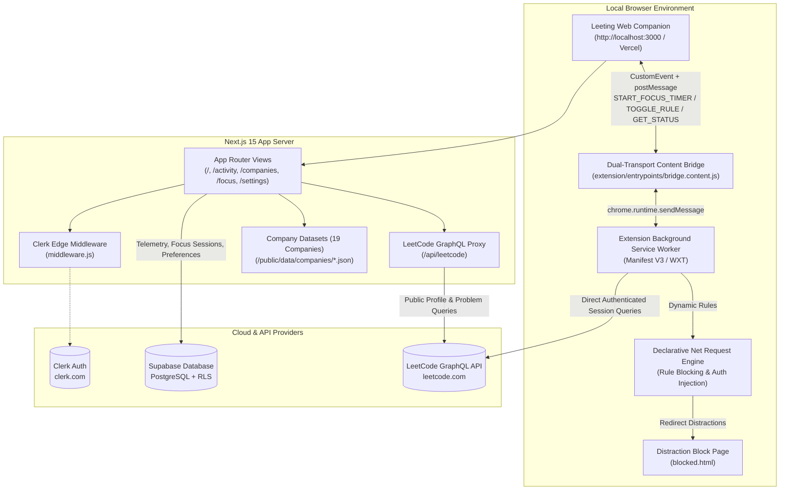

# Leeting — Algorithmic Consistency & Focus Companion (Monorepo)

[](tests/)
[](app/)
[](package.json)
[](tailwind.config.js)
[](lib/clerk-theme.js)
[](lib/supabase/)
[](extension/)
[](extension/)
[](extension/)
[](vercel.json)
[](LICENSE)

A unified monorepo housing the **Leeting** ecosystem: an all-in-one developer productivity platform designed to gamify, protect, and accelerate your algorithmic problem-solving habits.

1. **[Leeting Web](./app)**: High-performance desktop companion dashboard with **Obsidian Glassmorphism** (Light, Dark, and System modes), a 365-day consistency heatmap, a comprehensive **Company-Wise Interview Prep Matrix** (19 top tech firms, 3,000+ problems), a Pomodoro focus controller, and multi-device telemetry. Built with **Next.js 15 (App Router)**, **Tailwind CSS**, **Clerk Authentication**, and **Supabase (PostgreSQL)**.
2. **[Leeting Extension](./extension)**: Cross-browser **Manifest V3** extension for **Google Chrome**, **Microsoft Edge**, **Brave**, and **Mozilla Firefox**. Powered by **WXT**, **React**, and **Declarative Net Request**, featuring automated daily challenge tracking, live streak badges, upcoming contest alerts, and the signature **Solve Before Scroll** distraction shield.

---

## Visual Showcase

### Leeting Web Desktop Companion

| 365-Day Consistency Heatmap (Month Block Sections) | Obsidian Glassmorphism Welcome & Streak Hub |
| :---: | :---: |
|  |  |

#### Full Command Center View


### Leeting Browser Extension (Manifest V3)

| Expanded Popup Dashboard | Solve Before Scroll (Locked ON) | Ultra-Compact Collapsed State | Focus Block Shield (`blocked.html`) |
| :---: | :---: | :---: | :---: |
|  |  |  |  |

---

## Key Features

### 1. Company-Wise Interview Prep Matrix (`/companies`)
- **19 Top Tech Companies**: Google, Meta, Amazon, Microsoft, Apple, Netflix, Uber, Bloomberg, ByteDance, Adobe, LinkedIn, Salesforce, Oracle, Goldman Sachs, Nvidia, Airbnb, PayPal, Stripe, Tesla.
- **3,000+ Curated Problems**: Real-world interview questions tagged with exact difficulty, frequency percentage, and LeetCode problem URLs.
- **Timeframe Selector**: Dynamically filter questions by frequency in `30 Days`, `3 Months`, `6 Months`, or `All Time` with smooth animated sliding pill indicator.
- **Frequency Slider**: Filter problems by minimum appearance threshold (`0%` to `100%`).
- **Complete Topic Taxonomy**: Filter across all **173 LeetCode algorithmic topics** (Array, Dynamic Programming, Tree, Graph, Greedy, Backtracking, Trie, etc.) with real-time question counts.
- **Difficulty Badges**: Instant toggles for `Easy`, `Medium`, and `Hard` problems with count tallies.
- **Realistic Skeleton Transitions**: 2-second pulsating skeleton loader when switching companies or timeframes.
- **Interactive Progress Tracking**: "Mark Done" toggle with guest modal gate (full-viewport frosted glass backdrop blur via `createPortal`) for unauthenticated sessions.

### 2. 365-Day Consistency Matrix & Analytics (`/activity`)
- **Discrete 12-Month Heatmap**: 365-day solving activity visualizer segmented into monthly calendar grids.
- **Multi-Window Views**: Switch seamlessly between `90 Days`, `180 Days`, and `365 Days`.
- **Habit Cadence Engine**: Tracks active streak, longest streak, weekend consistency percentage, and daily solving velocity.
- **Zero-Leak Guest Standby**: When unauthenticated, displays clean guest notice without exposing mock identities.

### 3. Pomodoro Focus Controller & Live Distraction Shield (`/focus`)
- **Interactive Focus Timer**: Preset durations (`25m`, `45m`, `60m`, `90m`) and custom countdown.
- **Live Distraction Shield**: Remote-control browser extension blocking rules for:
  - **YouTube Shorts & Playables**: Auto-redirects `/shorts/` to `/watch` and blocks `/playables`.
  - **Instagram & Facebook**: Blocks feeds and redirects to dark obsidian focus page (`blocked.html`).
  - **LinkedIn Video**: Blocks video feeds and hides video tabs.
- **Cloud & Offline Session History**: Logs completed focus sessions locally with offline fallback and syncs to Supabase when connected.

### 4. Hybrid Obsidian Glassmorphism Design System
- **Three Theme Modes**: Full support for `Light`, `Dark`, and `System` with anti-flash SSR script.
- **CSS Design Tokens**: Semantic CSS variables (`--glass-bg`, `--glass-border`, `--glass-glow`, `--text-primary`, `--text-secondary`, etc.).
- **Scoped Clerk Auth Theming**: Ultra-refined Clerk authentication styling (`html.dark .cl-card` and `html.light .cl-card` via `lib/clerk-theme.js`) ensuring seamless contrast in both light and dark modes.
- **Clean Development Mode**: Stylistic suppression of `.cl-developmentModeBadge` during local development.

### 5. First-Time Extension Onboarding Banner
- **Browser Auto-Detection**: Automatically detects Chrome, Microsoft Edge, Brave, or Firefox.
- **One-Click Download Portal**: Direct browser-specific zip download served from `/downloads/leeting-extension-chrome.zip` and `/downloads/leeting-extension-firefox.zip`.
- **30-Second Setup Guide**: Collapsible step-by-step visual instructions for loading unpacked extensions.
- **Zero-Friction Persistence**: Remembers dismissal state in `localStorage` and auto-hides if the live extension bridge is already active.

### 6. Authenticated User Profile Caching
- **Instant Profile Rendering**: Caches authenticated LeetCode identity and stats in `localStorage` for returning users, eliminating initial page-load skeleton flickers.
- **Sidebar Identity Protection**: Only displays `{leetcodeId}'s Workspace` when an authenticated LeetCode identity exists; completely hides user ID line during guest sessions.

### 7. Production SEO, PWA & Vercel Readiness
- **Dynamic Favicon**: Vector flame squircle icon at `app/icon.svg`.
- **Dynamic Social Cards**: Automated OpenGraph and Twitter images via `app/opengraph-image.jsx`.
- **JSON-LD Structured Data**: Embedded search engine schemas (`WebSite`, `WebApplication`, `BreadcrumbList`).
- **Dynamic Crawl Directives**: Programmatic `app/robots.js` and `app/sitemap.js`.
- **Progressive Web App**: Full `app/manifest.js` configuration.
- **Hardened Security Headers**: Pre-configured `vercel.json` with `Content-Security-Policy`, `X-Content-Type-Options`, `X-Frame-Options`, `Referrer-Policy`, and edge asset caching.

---

## Monorepo Architecture

Leeting enforces a strict **zero-knowledge privacy model**: sensitive session cookies (`LEETCODE_SESSION`, `csrftoken`) remain exclusively inside your local browser extension context. The web companion communicates with the extension via a high-speed, local bidirectional message bridge (`CustomEvent` + `window.postMessage`).



---

## Monorepo Layout

```text
leeting_web/
├── app/                                # Next.js 15 App Router views
│   ├── icon.svg                        # Vector squircle flame favicon
│   ├── layout.jsx                      # Root layout (Glass Header, Sidebar, SEO metadata, JSON-LD)
│   ├── page.jsx                        # Command Center Dashboard & Welcome Hero
│   ├── opengraph-image.jsx             # Dynamic social sharing image generator
│   ├── robots.js                       # Dynamic robots.txt generator
│   ├── sitemap.js                      # Dynamic sitemap.xml generator
│   ├── manifest.js                     # PWA Web App manifest
│   ├── activity/
│   │   ├── layout.jsx                  # Route-specific SEO metadata
│   │   └── page.jsx                    # 365-Day Consistency Matrix (discrete month sections)
│   ├── companies/
│   │   ├── layout.jsx                  # Route-specific SEO metadata
│   │   └── page.jsx                    # Company-Wise Interview Prep Matrix (19 companies, 3,000+ problems)
│   ├── focus/
│   │   ├── layout.jsx                  # Route-specific SEO metadata
│   │   └── page.jsx                    # Focus timer, live shield toggles & session history
│   ├── settings/
│   │   ├── layout.jsx                  # Route-specific SEO metadata
│   │   └── page.jsx                    # Multi-instance device registry, quiet hours & theme config
│   ├── sign-in/[[...sign-in]]/         # High-contrast Clerk sign-in page
│   ├── sign-up/[[...sign-up]]/         # High-contrast Clerk sign-up page
│   └── api/leetcode/route.js           # Server-side proxy for LeetCode public GraphQL
├── components/                         # Reusable UI component modules
│   ├── layout/                         # Sidebar, Header, ThemeToggle, Live device sync pill
│   ├── cards/                          # StatCard, ChallengeCard, ContestCard, SkeletonCard
│   ├── focus/                          # FocusTimer, RuleToggle
│   └── extension/                      # ExtensionInstallPrompt (first-time onboarding)
├── lib/                                # Core application services & utilities
│   ├── services/                       # extension-bridge, focus-service, device-service, user-cache
│   ├── supabase/                       # Browser/server clients & RLS PostgreSQL schema
│   ├── clerk-theme.js                  # Light & Dark dynamic Clerk appearance config
│   ├── mock-data.js                    # Zero-dependency offline/unauthenticated fallback state
│   └── utils.js                        # Date, countdown, and class formatting helpers
├── public/
│   ├── data/companies/                 # Curated datasets for 19 tech companies + master catalog
│   ├── downloads/                      # Direct .zip extension release packages (Chrome & Firefox)
│   └── screenshots/                    # High-resolution dashboard screenshots
├── tests/                              # Web test harness (56 passing tests via node --test)
│   ├── auth.test.mjs                   # Authentication, user cache & guest fallback test suite
│   ├── bridge.test.mjs                 # Extension bridge & device registry test suite
│   ├── companies.test.mjs              # Company prep datasets, topics & filters test suite
│   ├── extension-prompt.test.mjs       # First-time onboarding banner test suite
│   ├── focus.test.mjs                  # Focus timer & cloud logging test suite
│   ├── leetcode-api.test.mjs           # LeetCode GraphQL schema & animation test suite
│   ├── preferences.test.mjs            # User preferences & quiet hours sync test suite
│   ├── seo.test.mjs                    # Favicon, robots, sitemap, manifest & vercel.json test suite
│   └── theme.test.mjs                  # Three-mode theme engine & anti-flash test suite
├── extension/                          # Cross-Browser Manifest V3 Extension package
│   ├── entrypoints/                    # Popup UI, background worker, bridge content script
│   ├── src/                            # Extension background lifecycle, DNR network, storage
│   ├── docs/screenshots/               # High-res extension popup screenshots
│   ├── tests/                          # Vitest test harness (76 passing tests)
│   │   ├── auth.test.js                # Cookie auth & header injection tests
│   │   ├── lifecycle.test.js           # Upgrade preservation (v1.0.8 -> v1.0.9) tests
│   │   ├── focus.test.js               # Focus shield & DNR redirect tests
│   │   └── worker.test.js              # Background alarm & notification tests
│   ├── PRIVACY.md                      # Detailed permissions and zero-tracking policy
│   ├── package.json                    # Extension package configuration
│   └── wxt.config.ts                   # WXT Manifest V3 multi-browser build config
├── vercel.json                         # Vercel deployment security headers & caching
├── pnpm-workspace.yaml                 # Monorepo workspace definition
├── package.json                        # Root package configuration & unified CLI scripts
└── README.md                           # Unified monorepo documentation
```

---

## Unified Command Center

The root `package.json` provides unified scripts to build, test, package, and develop both packages simultaneously:

| Command | Action | Output / Target |
| :--- | :--- | :--- |
| `pnpm dev` | Starts the Next.js 15 Web Companion | `http://localhost:3000` |
| `pnpm dev:ext` | Starts the Extension development watcher | `extension/.output/chrome-mv3` |
| `pnpm build` | Builds the Next.js Web Companion for production | `.next/` production build |
| `pnpm build:ext` | Builds Chromium MV3 extension (Chrome, Edge, Brave) | `extension/.output/chrome-mv3` |
| `pnpm build:firefox`| Builds Firefox MV3 extension (Gecko) | `extension/.output/firefox-mv3` |
| `pnpm build:all` | Compiles both Web App and Chromium Extension | Full production validation |
| `pnpm zip:ext` | Packages distributable Chrome/Edge archive | `extension/.output/leeting-1.0.9-chrome.zip` |
| `pnpm zip:firefox` | Packages distributable Firefox archive | `extension/.output/leeting-1.0.9-firefox.zip` |
| `pnpm test` | Runs Web Companion test suites | 56 tests via `node --test` |
| `pnpm test:ext` | Runs Extension test suites | 76 tests via `vitest run` |
| `pnpm test:all` | Runs **all 132 automated tests** in sequence | Complete monorepo verification |

---

## Quick Start & Installation

### Prerequisites
- **Node.js**: `v20.0.0` or higher
- **pnpm**: `v9.0.0` or higher (`corepack enable && corepack prepare pnpm@latest --activate`)

### 1. Clone & Install Workspace

```bash
git clone https://github.com/anirban-moi/leeting_web.git
cd leeting_web

# Install all dependencies across the monorepo workspace
pnpm install
```

### 2. Configure Environment Variables

Create `.env.local` by copying `.env.example`:

```bash
cp .env.example .env.local
```

Fill in your Clerk and Supabase credentials in `.env.local`:

```env
# Clerk Authentication (https://dashboard.clerk.com)
NEXT_PUBLIC_CLERK_PUBLISHABLE_KEY=pk_test_...
CLERK_SECRET_KEY=sk_test_...

NEXT_PUBLIC_CLERK_SIGN_IN_URL=/sign-in
NEXT_PUBLIC_CLERK_SIGN_UP_URL=/sign-up
NEXT_PUBLIC_CLERK_AFTER_SIGN_IN_URL=/
NEXT_PUBLIC_CLERK_AFTER_SIGN_UP_URL=/

# Site Canonical URL (for SEO / OpenGraph)
NEXT_PUBLIC_SITE_URL=http://localhost:3000

# Optional Chrome Web Store Link
NEXT_PUBLIC_CHROME_WEBSTORE_URL=https://chrome.google.com/webstore/...

# Supabase PostgreSQL (https://supabase.com)
NEXT_PUBLIC_SUPABASE_URL=https://your-project-id.supabase.co
NEXT_PUBLIC_SUPABASE_ANON_KEY=sb_publishable_...
```

> **Note**: Leeting Web includes complete, self-healing mock fallbacks. If no Clerk or Supabase keys are provided, the web application runs entirely offline with full UI and local storage capabilities.

### 3. Run Web Companion Locally

```bash
pnpm dev
```
Open [http://localhost:3000](http://localhost:3000) in your browser.

---

## Deploying to Vercel

Leeting Web is fully optimized for **zero-config deployment on Vercel**.

### Method A: Deploy via Vercel Dashboard (Recommended)

1. Push your repository to GitHub, GitLab, or Bitbucket.
2. Log into [Vercel](https://vercel.com/) and click **Add New Project**.
3. Import your `leeting_web` repository.
4. Set the **Framework Preset** to **Next.js**.
5. Add the following **Environment Variables** in the Vercel project settings:
   - `NEXT_PUBLIC_CLERK_PUBLISHABLE_KEY`: Your Clerk Publishable Key (`pk_live_...` for production or `pk_test_...` for preview)
   - `CLERK_SECRET_KEY`: Your Clerk Secret Key (`sk_live_...` or `sk_test_...`)
   - `NEXT_PUBLIC_CLERK_SIGN_IN_URL`: `/sign-in`
   - `NEXT_PUBLIC_CLERK_SIGN_UP_URL`: `/sign-up`
   - `NEXT_PUBLIC_CLERK_AFTER_SIGN_IN_URL`: `/`
   - `NEXT_PUBLIC_CLERK_AFTER_SIGN_UP_URL`: `/`
   - `NEXT_PUBLIC_SITE_URL`: `https://your-app-name.vercel.app` (or custom domain)
   - `NEXT_PUBLIC_SUPABASE_URL`: (Optional) Your Supabase project URL
   - `NEXT_PUBLIC_SUPABASE_ANON_KEY`: (Optional) Your Supabase anonymous key
6. Click **Deploy**. Vercel will build and deploy the Next.js App Router application automatically.

### Method B: Deploy via Vercel CLI

```bash
# Install Vercel CLI globally
npm i -g vercel

# Deploy preview build
vercel

# Deploy production build
vercel --prod
```

### Production Clerk Keys
When going live, make sure to:
1. Transition your Clerk Dashboard from **Development Instance** to **Production Instance**.
2. Update `NEXT_PUBLIC_CLERK_PUBLISHABLE_KEY` (`pk_live_...`) and `CLERK_SECRET_KEY` (`sk_live_...`) in your Vercel Environment Variables.
3. Configure your production domain under Clerk Dashboard → **Domains**.

---

## Browser Extension Installation

### Option A: Install Pre-Built Release Archives (No Build Needed)

Pre-built zip archives are located in `extension/.output/` (and directly downloadable from the web app's first-time onboarding prompt):

- **Chrome / Edge / Brave / Opera**: `extension/.output/leeting-1.0.9-chrome.zip` (or `/downloads/leeting-extension-chrome.zip`)
- **Mozilla Firefox**: `extension/.output/leeting-1.0.9-firefox.zip` (or `/downloads/leeting-extension-firefox.zip`)

#### Google Chrome / Brave / Opera
1. Extract `leeting-1.0.9-chrome.zip` to a local folder.
2. Navigate to `chrome://extensions/` and enable **Developer mode** (toggle at top right).
3. Click **Load unpacked** and select the unzipped directory.
4. Pin **Leeting** from the toolbar puzzle icon.

#### Microsoft Edge
1. Extract `leeting-1.0.9-chrome.zip`.
2. Navigate to `edge://extensions/` and enable **Developer mode** (toggle on left sidebar).
3. Click **Load unpacked** and choose the extracted folder.

#### Mozilla Firefox (Firefox 113+ MV3)
1. Navigate to `about:debugging#/runtime/this-firefox`.
2. Click **Load Temporary Add-on...** and select `leeting-1.0.9-firefox.zip` (or extract it and select `manifest.json`).
3. *(Important for Firefox)* Go to `about:addons` → **Leeting** → **Permissions** and ensure **Access your data for all websites / listed hosts** is toggled ON to enable Declarative Net Request redirects and cookie synchronization.

### Option B: Build Extension from Source

```bash
# Build Chrome/Edge MV3 into extension/.output/chrome-mv3
pnpm build:ext

# Build Firefox MV3 into extension/.output/firefox-mv3
pnpm build:firefox

# Generate production zip archives
pnpm zip:ext
pnpm zip:firefox
```
Load the compiled output from `extension/.output/chrome-mv3` or `extension/.output/firefox-mv3` into your browser.

---

## Extension Upgrades (Data Preservation)

Leeting guarantees **zero data loss** across version upgrades (e.g., upgrading from `v1.0.8` to `v1.0.9`):

1. Unzip the new version into the **same directory** where the previous version was loaded.
2. Open `chrome://extensions` or `edge://extensions` and click the **Reload** (`↻`) button on Leeting.
3. **Do not click Remove**: Removing an unpacked extension deletes browser-scoped `chrome.storage.local`. Clicking **Reload** preserves all stored preferences, streak records, Solve Before Scroll auto-lock flags, and coin claim history.
4. This upgrade behavior is verified by automated test suite `extension/tests/lifecycle.test.js`.

---

## Automated Test Suites (132/132 Passing)

Run the automated test suites:

```bash
# Run Web Companion tests (56 tests)
pnpm test

# Run Extension tests (76 tests)
pnpm test:ext

# Run all 132 tests across the monorepo
pnpm test:all
```

### 1. Web Companion Test Suites (56 Tests Passing)
| Test Suite | Spec File | Coverage Highlights |
| :--- | :--- | :--- |
| **Authentication & Profile** | `tests/auth.test.mjs` | Unauthenticated fallback profiles, user cache mechanics, guest standby states, scoped Clerk styling, sidebar user ID isolation |
| **Extension Bridge & Devices** | `tests/bridge.test.mjs` | Dual-transport bridge, heartbeat registration, device registry deduplication, root provider integration |
| **Company Prep Matrix** | `tests/companies.test.mjs` | 19 company dataset validation, master catalog, timeframe switching, frequency slider, 173 topics completeness |
| **First-Time Install Banner** | `tests/extension-prompt.test.mjs` | Browser auto-detection, pre-packaged zip downloads, 30s guide, localStorage dismissal persistence, active bridge suppression |
| **Focus Timer & Shield** | `tests/focus.test.mjs` | Local logging fallback when Supabase is disconnected, historical session recovery, distraction rule validation |
| **LeetCode API & Models** | `tests/leetcode-api.test.mjs` | Duration formatters, daily challenge schema validation, difficulty stat percentages, wave animation triggers |
| **User Preferences** | `tests/preferences.test.mjs` | Default preferences fallback, quiet hours scheduling, user settings persistence |
| **SEO & Deployment** | `tests/seo.test.mjs` | Vector squircle favicon (`icon.svg`), JSON-LD schema, dynamic robots, sitemap, manifest, sub-route metadata, `vercel.json` headers |
| **Theme Engine** | `tests/theme.test.mjs` | Light/Dark/System modes, SSR anti-flash inline script, Obsidian CSS glass tokens, ThemeToggle integration |

### 2. Browser Extension Test Suites (76 Tests Passing)
| Test Suite | Spec File | Coverage Highlights |
| :--- | :--- | :--- |
| **Authentication & Headers** | `extension/tests/auth.test.js` | Cookie extraction, zero-knowledge storage, fallback from `set` to `append` operation |
| **Lifecycle & Upgrades** | `extension/tests/lifecycle.test.js` | `onInstalled` triggers, background alarms, v1.0.8 → v1.0.9 non-destructive data migration |
| **Background Worker** | `extension/tests/worker.test.js` | 30-minute daily challenge polling, contest notifications, streak caching |
| **Focus Mode & DNR** | `extension/tests/focus.test.js`, `network.test.js` | YouTube Shorts/Playables redirection, Instagram, Facebook, and LinkedIn Video blocking rules |
| **LeetCode GraphQL Engine** | `extension/tests/leetcode.test.js` | Authenticated vs public GraphQL query fallback, error boundaries, response parsing |
| **Cross-Browser Manifests** | `extension/tests/manifest.test.js`, `build.test.js` | MV3 schema compliance for Chromium and Gecko engines |

---

## Privacy, Security & Permissions

1. **Zero LeetCode Credentials Transmitted**: Leeting never asks for, logs, or transmits your LeetCode password or session tokens to external servers. Authentication with `leetcode.com/graphql` occurs locally in your browser.
2. **Local-First Architecture**: Distraction blocking and session counters function 100% offline without requiring internet connectivity or third-party servers.
3. **Row-Level Security (RLS)**: When connected to Supabase, all PostgreSQL tables (`user_preferences`, `focus_sessions`, `devices`) enforce RLS policies locked strictly to your Clerk user ID.
4. **Permissions Transparency**:
   - `storage`: Preserves focus preferences, coin claim dates, and cached streaks locally.
   - `alarms`: Schedules 30m challenge checks and 60m contest notifications.
   - `notifications`: Triggers local desktop reminders 45 minutes before LeetCode contests.
   - `cookies` (`*.leetcode.com`): Reads local session cookie to query your streak and solve status.
   - `declarativeNetRequest`: Attaches auth headers exclusively to extension GraphQL requests and redirects distracting sites to `blocked.html` when Focus Mode is ON.
   - Host permissions (`youtube.com`, `instagram.com`, `facebook.com`, `fb.com`, `linkedin.com`): Distraction shield enforcement.
   - Host permissions (`http://localhost/*`, `http://127.0.0.1/*`): Local dual-transport bridge connection to Leeting Web.

For complete legal and permission disclosures, read [extension/PRIVACY.md](./extension/PRIVACY.md).

---

## Verified Browsers

| Browser | Manifest Engine | Status | Notes |
| :--- | :--- | :--- | :--- |
| **Google Chrome** | Manifest V3 (Blink) | Verified | Full background service worker, DNR rules & cookie sync |
| **Microsoft Edge** | Manifest V3 (Blink) | Verified | Tested with isolated world dual-transport bridge |
| **Brave / Opera** | Manifest V3 (Blink) | Verified | Full feature parity with Chrome |
| **Mozilla Firefox** | Manifest V3 (Gecko 113+) | Verified | Full MV3 background scripts & DNR redirects |

---

## License

MIT © [Anirban](https://github.com/anirban-moi)
