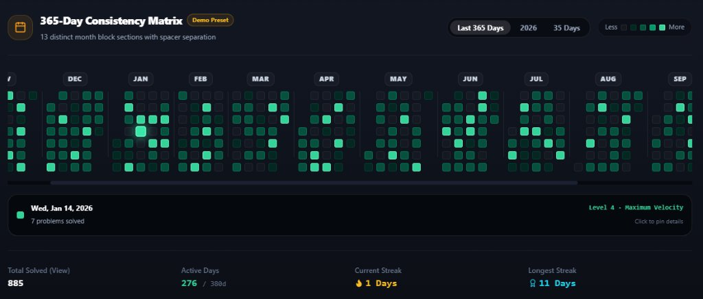
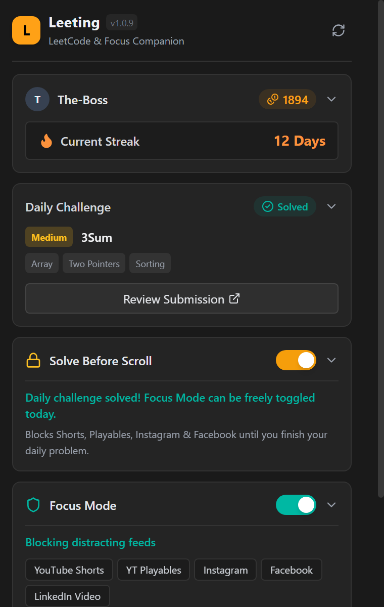
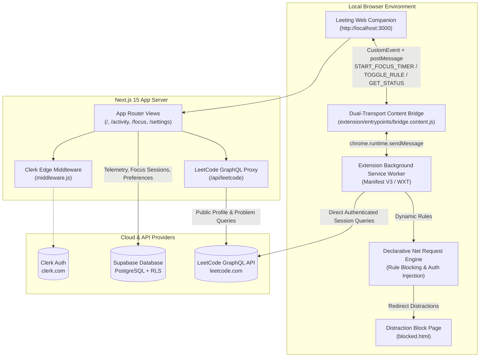

# Leeting — Algorithmic Consistency & Focus Companion (Monorepo)

[](tests/)
[](app/)
[](extension/)
[](extension/)
[](extension/)
[](LICENSE)

A unified monorepo housing the **Leeting** ecosystem: an all-in-one platform designed to gamify and protect your daily LeetCode consistency.

1. **[Leeting Web](./app)**: High-performance desktop companion dashboard with **Obsidian Glassmorphism**, 365-day consistency matrix, Pomodoro focus controller, and cross-device telemetry. Built with **Next.js 15 (App Router)**, **Tailwind CSS**, **Clerk Authentication**, and **Supabase (PostgreSQL)**.
2. **[Leeting Extension](./extension)**: Cross-browser **Manifest V3** extension for **Google Chrome**, **Microsoft Edge**, and **Mozilla Firefox**. Powered by **WXT**, **React**, and **Declarative Net Request**, featuring automated daily challenge tracking, live streak badges, upcoming contest alerts, and the signature **Solve Before Scroll** distraction blocker.

---

## Visual Showcase

### Leeting Web Desktop Companion

| 365-Day Consistency Heatmap (Month Block Sections) | Obsidian Glassmorphism Welcome & Streak Hub |
| :---: | :---: |
|  |  |

#### Full Command Center View


### Leeting Browser Extension (Manifest V3)

| Expanded Popup Dashboard | Solve Before Scroll (Locked ON) | Ultra-Compact Collapsed State | Focus Block Shield (`blocked.html`) |
| :---: | :---: | :---: | :---: |
|  |  |  |  |

---

## Monorepo Architecture

Leeting enforces a strict **zero-knowledge privacy model**: sensitive session cookies (`LEETCODE_SESSION`, `csrftoken`) remain exclusively inside your local browser extension context. The web companion communicates with the extension via a high-speed, local bidirectional message bridge (`CustomEvent` + `window.postMessage`).



---

## Monorepo Layout

```text
leeting_web/
├── app/                        # Next.js 15 App Router views
│   ├── layout.jsx              # Root layout with Obsidian Glass Header & Sidebar
│   ├── page.jsx                # Command Center Dashboard
│   ├── activity/page.jsx       # 365-Day Consistency Matrix (discrete month sections)
│   ├── focus/page.jsx          # Focus timer, live shield toggles & session history
│   ├── settings/page.jsx       # Multi-instance device registry & quiet hours
│   └── api/leetcode/route.js   # Server-side proxy for LeetCode public GraphQL
├── components/                 # Reusable UI component modules
│   ├── layout/                 # Sidebar, Header, Live device sync pill
│   ├── cards/                  # StatCard, ChallengeCard, ContestCard
│   └── focus/                  # FocusTimer, RuleToggle
├── lib/                        # Core application services & utilities
│   ├── services/               # extension-bridge, focus-service, device-service
│   ├── supabase/               # Browser/server clients & RLS PostgreSQL schema
│   ├── mock-data.js            # Zero-dependency offline/unauthenticated fallback state
│   └── utils.js                # Date, countdown, and class formatting helpers
├── public/screenshots/         # High-resolution dashboard screenshots
├── tests/                      # Web test harness (14 passing tests via node --test)
│   ├── auth.test.mjs           # Authentication & profile fallback test suite
│   ├── bridge.test.mjs         # Extension bridge & device registry test suite
│   ├── focus.test.mjs          # Focus timer & cloud logging test suite
│   ├── leetcode-api.test.mjs   # LeetCode GraphQL schema validation test suite
│   └── preferences.test.mjs    # User preferences & quiet hours sync test suite
├── extension/                  # Cross-Browser Manifest V3 Extension package
│   ├── entrypoints/            # Popup UI, background worker, bridge content script
│   ├── src/                    # Extension background lifecycle, DNR network, storage
│   ├── docs/screenshots/       # High-res extension popup screenshots
│   ├── tests/                  # Vitest test harness (76 passing tests)
│   │   ├── auth.test.js        # Cookie auth & header injection tests
│   │   ├── lifecycle.test.js   # Upgrade preservation (v1.0.8 -> v1.0.9) tests
│   │   ├── focus.test.js       # Focus shield & DNR redirect tests
│   │   └── worker.test.js      # Background alarm & notification tests
│   ├── PRIVACY.md              # Detailed permissions and zero-tracking policy
│   ├── package.json            # Extension package configuration
│   └── wxt.config.ts           # WXT Manifest V3 multi-browser build config
├── pnpm-workspace.yaml         # Monorepo workspace definition
├── package.json                # Root package configuration & unified CLI scripts
└── README.md                   # Unified monorepo documentation
```

---

## Unified Command Center

The root `package.json` provides unified scripts to build, test, package, and develop both packages simultaneously:

| Command | Action | Output / Target |
| :--- | :--- | :--- |
| `pnpm dev` | Starts the Next.js 15 Web Companion | `http://localhost:3000` |
| `pnpm dev:ext` | Starts the Extension development watcher | `extension/.output/chrome-mv3` |
| `pnpm build` | Builds the Next.js Web Companion | `.next/` production build |
| `pnpm build:ext` | Builds Chromium MV3 extension (Chrome, Edge) | `extension/.output/chrome-mv3` |
| `pnpm build:firefox`| Builds Firefox MV3 extension (Gecko) | `extension/.output/firefox-mv3` |
| `pnpm build:all` | Compiles both Web App and Chromium Extension | Full production validation |
| `pnpm zip:ext` | Packages distributable Chrome/Edge archive | `extension/.output/leeting-1.0.9-chrome.zip` |
| `pnpm zip:firefox` | Packages distributable Firefox archive | `extension/.output/leeting-1.0.9-firefox.zip` |
| `pnpm test` | Runs Web Companion test suites | 14 tests via `node --test` |
| `pnpm test:ext` | Runs Extension test suites | 76 tests via `vitest run` |
| `pnpm test:all` | Runs **all 90 automated tests** in sequence | Complete monorepo verification |

---

## Quick Start & Installation

### Prerequisites
- **Node.js**: v20.0.0 or higher
- **pnpm**: v9.0.0 or higher (`corepack enable && corepack prepare pnpm@latest --activate`)

### 1. Clone & Install Workspace

```bash
git clone https://github.com/anirban-moi/leeting_web.git
cd leeting_web

# Install all dependencies across the monorepo workspace
pnpm install
```

### 2. Configure Web Environment Variables

Copy `.env.example` to `.env.local`:

```bash
cp .env.example .env.local
```

Fill in your Clerk and Supabase credentials in `.env.local`:

```env
# Clerk Authentication (https://dashboard.clerk.com)
NEXT_PUBLIC_CLERK_PUBLISHABLE_KEY=pk_test_...
CLERK_SECRET_KEY=sk_test_...

NEXT_PUBLIC_CLERK_SIGN_IN_URL=/sign-in
NEXT_PUBLIC_CLERK_SIGN_UP_URL=/sign-up
NEXT_PUBLIC_CLERK_AFTER_SIGN_IN_URL=/
NEXT_PUBLIC_CLERK_AFTER_SIGN_UP_URL=/

# Supabase PostgreSQL (https://supabase.com)
NEXT_PUBLIC_SUPABASE_URL=https://your-project-id.supabase.co
NEXT_PUBLIC_SUPABASE_ANON_KEY=sb_publishable_...
```

> **Note**: Leeting Web includes complete, self-healing mock fallbacks. If no Clerk or Supabase keys are provided, the web application runs entirely offline with full UI capabilities.

### 3. Run Web Companion Locally

```bash
pnpm dev
```
Open [http://localhost:3000](http://localhost:3000) in your browser.

---

## Browser Extension Installation

### Option A: Install Pre-Built Release Archives (No Build Needed)

Pre-built zip archives are located in `extension/.output/` (or on GitHub Releases):

- **Chrome / Edge / Brave / Opera**: `extension/.output/leeting-1.0.9-chrome.zip`
- **Mozilla Firefox**: `extension/.output/leeting-1.0.9-firefox.zip`

#### Google Chrome / Brave / Opera
1. Extract `leeting-1.0.9-chrome.zip` to a folder.
2. Navigate to `chrome://extensions/` and enable **Developer mode** (top right).
3. Click **Load unpacked** and select the unzipped directory.
4. Pin **Leeting** from the toolbar puzzle icon.

#### Microsoft Edge
1. Extract `leeting-1.0.9-chrome.zip`.
2. Navigate to `edge://extensions/` and enable **Developer mode** (left sidebar).
3. Click **Load unpacked** and choose the extracted folder.

#### Mozilla Firefox (Firefox 113+ MV3)
1. Navigate to `about:debugging#/runtime/this-firefox`.
2. Click **Load Temporary Add-on...** and select `leeting-1.0.9-firefox.zip` (or extract it and select `manifest.json`).
3. *(Important for Firefox)* Go to `about:addons` → **Leeting** → **Permissions** and ensure **Access your data for all websites / listed hosts** is toggled ON to enable Declarative Net Request redirects and cookie synchronization.

### Option B: Build Extension from Source

```bash
# Build Chrome/Edge MV3
pnpm build:ext

# Build Firefox MV3
pnpm build:firefox

# Generate production zip archives
pnpm zip:ext
pnpm zip:firefox
```
Load the compiled output from `extension/.output/chrome-mv3` or `extension/.output/firefox-mv3` into your browser.

---

## Extension Upgrades (Data Preservation)

Leeting guarantees **zero data loss** across version upgrades (e.g., upgrading from `v1.0.8` to `v1.0.9`):

1. Unzip the new version into the **same directory** where the previous version was loaded.
2. Open `chrome://extensions` or `edge://extensions` and click the **Reload** (`↻`) button on Leeting.
3. **Do not click Remove**: Removing an unpacked extension deletes browser-scoped `chrome.storage.local`. Clicking **Reload** preserves all stored preferences, streak records, Solve Before Scroll auto-lock flags, and coin claim history.
4. This upgrade behavior is verified by automated test suite `extension/tests/lifecycle.test.js`.

---

## Automated Test Suites (90/90 Passing)

Run the complete monorepo test suite in a single command:

```bash
pnpm test:all
```

### 1. Web Companion Test Suite (14 Tests)
- **Authentication & Fallback Profiles (`tests/auth.test.mjs`)**: Null-safe user profile handling, unauthenticated mock fallbacks, and schema integrity.
- **Extension Bridge & Device Registry (`tests/bridge.test.mjs`)**: Dual-transport message channel verification, heartbeat registration, and device fallback listing.
- **Focus Timer & Cloud Logging (`tests/focus.test.mjs`)**: Local offline logging when Supabase is disconnected, historical session fetching, and rule domain validations.
- **LeetCode Models & Helpers (`tests/leetcode-api.test.mjs`)**: Duration formatters, daily challenge schema parsing, and difficulty percentage calculations.
- **User Preferences (`tests/preferences.test.mjs`)**: Preference defaults and quiet hours persistence.

### 2. Browser Extension Test Suite (76 Tests)
- **Authentication & Headers (`extension/tests/auth.test.js`)**: Cookie extraction, zero-knowledge storage, and fallback from `set` to `append` operation.
- **Lifecycle & Upgrades (`extension/tests/lifecycle.test.js`)**: `onInstalled` triggers, background alarms, and v1.0.8 → v1.0.9 non-destructive data migration.
- **Background Worker (`extension/tests/worker.test.js`)**: 30-minute daily challenge polling, contest alarms, and streak caching.
- **Focus Mode & DNR (`extension/tests/focus.test.js`, `extension/tests/network.test.js`)**: YouTube Shorts/Playables redirection, Instagram, Facebook, and LinkedIn Video blocking rules.
- **LeetCode GraphQL Engine (`extension/tests/leetcode.test.js`)**: Authenticated vs public GraphQL query fallback, error boundaries, and response parsing.
- **Cross-Browser Manifests & Builds (`extension/tests/manifest.test.js`, `extension/tests/build.test.js`)**: MV3 schema compliance for Chromium and Gecko engines.

---

## Privacy, Security & Permissions

1. **Zero LeetCode Credentials Transmitted**: Leeting never asks for, logs, or transmits your LeetCode password or session tokens to external servers. Authentication with `leetcode.com/graphql` occurs locally in your browser.
2. **Local-First Architecture**: Distraction blocking and session counters function 100% offline without requiring internet connectivity or third-party servers.
3. **Row-Level Security (RLS)**: When connected to Supabase, all PostgreSQL tables (`user_preferences`, `focus_sessions`, `devices`) enforce RLS policies locked strictly to your Clerk user ID.
4. **Permissions Transparency**:
   - `storage`: Preserves focus preferences, coin claim dates, and cached streaks locally.
   - `alarms`: Schedules 30m challenge checks and 60m contest notifications.
   - `notifications`: Triggers local desktop reminders 45 minutes before LeetCode contests.
   - `cookies` (`*.leetcode.com`): Reads local session cookie to query your streak and solve status.
   - `declarativeNetRequest`: Attaches auth headers exclusively to extension GraphQL requests and redirects distracting sites to `blocked.html` when Focus Mode is ON.
   - Host permissions (`youtube.com`, `instagram.com`, `facebook.com`, `fb.com`, `linkedin.com`): Distraction shield enforcement.
   - Host permissions (`http://localhost/*`, `http://127.0.0.1/*`): Local dual-transport bridge connection to Leeting Web.

For complete legal and permission disclosures, read [extension/PRIVACY.md](./extension/PRIVACY.md).

---

## Verified Browsers

| Browser | Manifest Engine | Status | Notes |
| :--- | :--- | :--- | :--- |
| **Google Chrome** | Manifest V3 (Blink) | Verified | Full background service worker, DNR rules & cookie sync |
| **Microsoft Edge** | Manifest V3 (Blink) | Verified | Tested with isolated world dual-transport bridge |
| **Brave / Opera** | Manifest V3 (Blink) | Verified | Full feature parity with Chrome |
| **Mozilla Firefox** | Manifest V3 (Gecko 113+) | Verified | Full MV3 background scripts & DNR redirects |

---

## License

MIT © [Anirban](https://github.com/anirban-moi)
