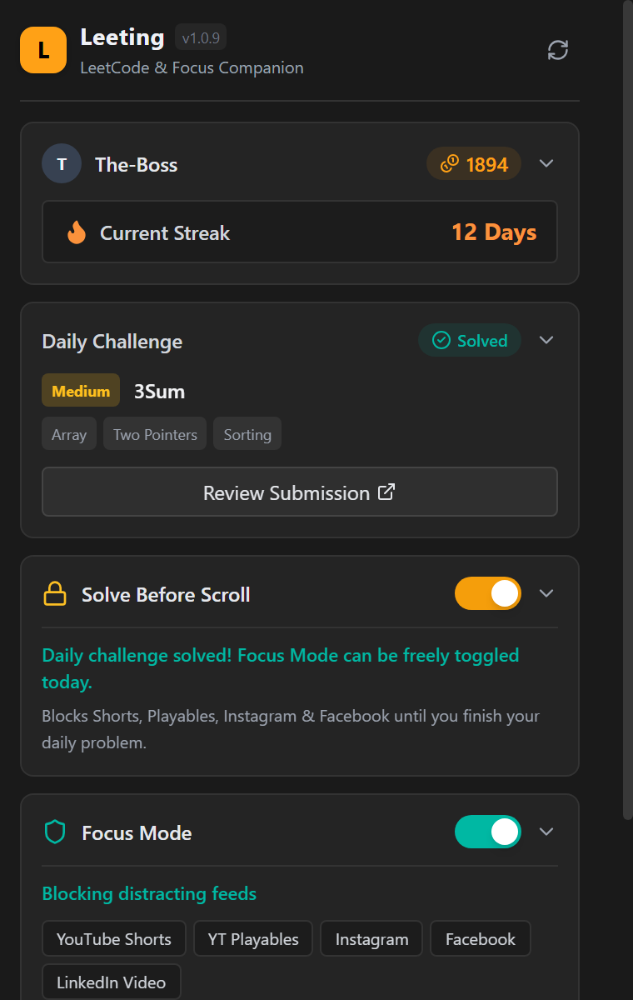
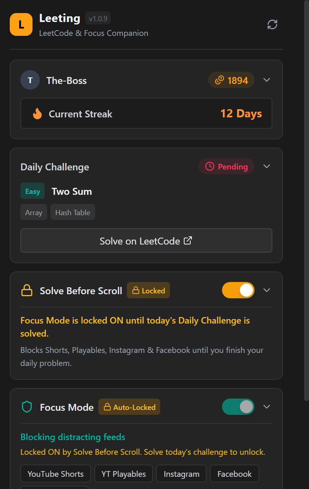
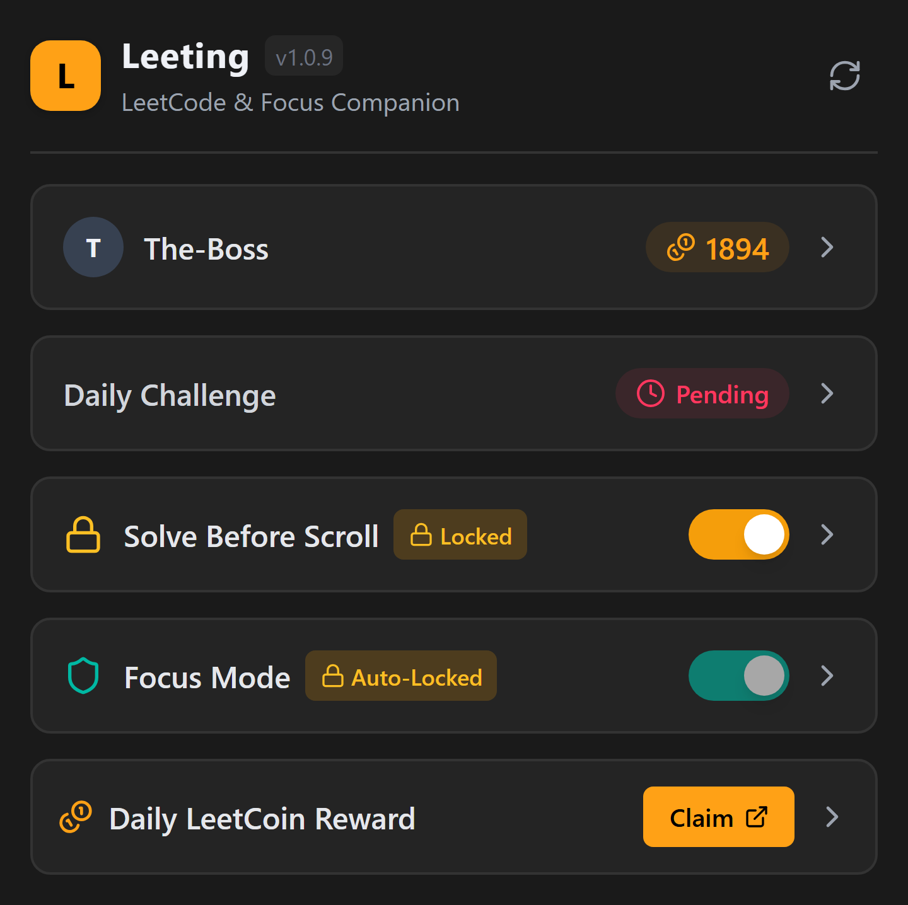
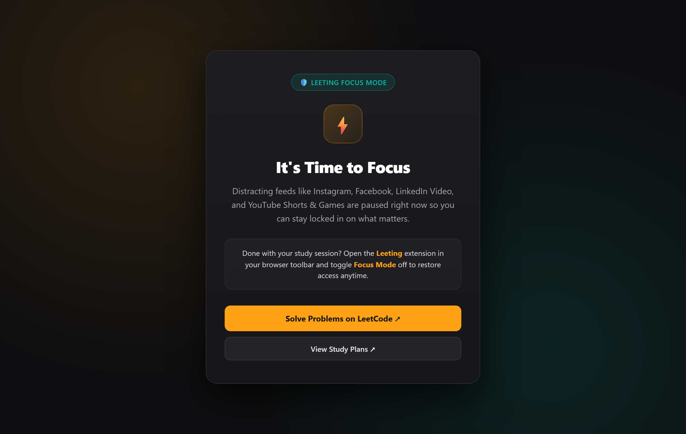
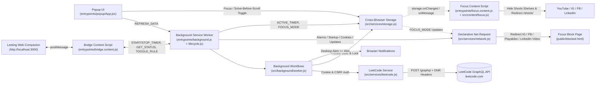

# Leeting — LeetCode & Focus Companion

A lightweight, privacy-first **Manifest V3** browser extension for **Google Chrome**, **Microsoft Edge**, and **Mozilla Firefox** built with **WXT**, **React**, and **Tailwind CSS**.

Leeting keeps your LeetCode Daily Coding Challenge, active streak, LeetCoins, and contest alerts one click away while blocking distracting short-form feeds until your daily problem is done.

---

## Features

- **LeetCode Cookie-Based Sync & Auth**: Uses your existing browser `LEETCODE_SESSION` and `csrftoken` cookies via `declarativeNetRequest` headers (`https://leetcode.com/graphql`) — zero passwords stored, zero scripts injected into `leetcode.com`.
- **Daily Challenge Card & Toolbar Badge**: Displays today's problem title, difficulty pill (`Easy` / `Medium` / `Hard`), up to 3 topic tags, live `Solved` / `Pending` badge, and updates the toolbar icon (`!` while pending, teal streak count or `✓` once solved).
- **Current Streak Counter**: Tracks your active solving streak and LeetCoin balance with cached-first loading and 30-minute background syncs.
- **Upcoming Contest Countdown & Alerts**: Shows a live countdown for the next LeetCode contest and triggers a clickable desktop notification **45 minutes** before start.
- **Daily LeetCoin Reward Shortcut**: Tracks daily check-in state and opens `https://leetcode.com/store/` in one click.
- **Focus Mode Distraction Blocker**:
  - **YouTube**: Redirects `/shorts/<id>` to normal `/watch?v=<id>`, blocks `/playables`, and hides Shorts & Playables shelves/sidebar links.
  - **Instagram & Facebook**: Redirects `instagram.com`, `facebook.com`, and `fb.com` to the built-in dark-mode Focus block page (`blocked.html`).
  - **LinkedIn**: Redirects `linkedin.com/video` to `blocked.html` and hides `/video` navigation tabs, carousels, and short-form video posts.
- **Solve Before Scroll Mode**: Automatically turns **Focus Mode** ON and locks the manual toggle whenever you are signed in and today's Daily Challenge is unsolved — unlocking automatically the moment you solve it.
- **Smooth Collapsible Accordion & Compact UI**: Every section features a collapsible dropdown that shrinks down to an ultra-compact ~359px popup. Uses CSS Grid row interpolation and Material standard easing (`cubic-bezier(0.4, 0, 0.2, 1)`) so lower modules glide up and down smoothly at ease.
- **Browser Startup Alerts**: On browser startup, Leeting checks and sends a local notification if today's Daily Challenge is pending or if a contest is starting soon (with a prompt to log in if signed out).
- **Safe Extension Upgrades**: Persists all Focus Mode settings, Solve Before Scroll state, coin claim history, contest notifications, and cached dashboard state safely across extension upgrades (including upgrades from `v1.0.8` → `v1.0.9`).
- **Live Companion Web Bridge**: Bi-directional remote control with **Leeting Web** (`leeting_web`) via `window.postMessage` — toggling distraction rules, starting Pomodoro timers, and streaming live LeetCode stats with sub-10ms latency.
- **Focus Session Remote Timer Sync**: Synchronizes active Pomodoro timers (`25m`, `45m`, `60m`, `90m`) with background tabs, automatically locking focus while the timer counts down.

---

## Screenshots

| Expanded Dashboard | Solve Before Scroll (Locked ON) | Ultra-Compact Collapsed State |
| :---: | :---: | :---: |
|  |  |  |

### Focus Mode Block Page (`blocked.html`)


---

## Architecture



---

## Permissions & Privacy

Leeting operates **100% locally** and never transmits cookies, browsing data, or analytics to any third-party server. See the full [Privacy & Permissions Policy](PRIVACY.md) for details.

| Permission / Host | Why It Is Used |
| :--- | :--- |
| `storage` | Stores Focus Mode preferences, Solve Before Scroll lock state, cached Daily Challenge/user profile, active timer state, coin check-in date, and notified contest history locally. |
| `alarms` | Runs periodic background syncs (Daily Challenge every 30 min, Contests every 60 min). |
| `notifications` | Notifies you 45 minutes before an upcoming LeetCode contest begins. |
| `cookies` (`*.leetcode.com`) | Reads `LEETCODE_SESSION` & `csrftoken` to authenticate your personal LeetCode streak and daily solve status. |
| `declarativeNetRequest` & `declarativeNetRequestWithHostAccess` | Attaches auth headers strictly on extension-initiated `leetcode.com/graphql` requests and redirects blocked distraction sites to `blocked.html` when Focus Mode is ON. |
| Host permissions (`leetcode.com`, `youtube.com`, `instagram.com`, `facebook.com`, `fb.com`, `linkedin.com`) | Enables LeetCode API authentication and Focus Mode blocking on distraction domains. Zero content scripts are injected on `leetcode.com`. |
| Host permissions (`http://localhost/*`, `http://127.0.0.1/*`) | Enables the secure content script bridge to connect with the companion dashboard (`leeting_web`) on your local machine for remote timer and distraction control. |

---

## Installation

### Method 1: Install Pre-Built Release (Recommended — No build needed)

Download the pre-built zip archive for your browser from the [GitHub Releases](https://github.com/anirban-moi/leeting/releases) page:

- **Chrome / Edge**: `leeting-1.0.9-chrome.zip`
- **Firefox (MV3)**: `leeting-1.0.9-firefox.zip`

#### Google Chrome
1. Unzip `leeting-1.0.9-chrome.zip` into a folder (for example, `leeting-chrome/`).
2. Open `chrome://extensions` and enable **Developer mode** (toggle at top right).
3. Click **Load unpacked** and select the extracted folder.
4. Pin **Leeting** from the Extensions toolbar puzzle icon.

#### Microsoft Edge
1. Unzip `leeting-1.0.9-chrome.zip` into a folder.
2. Open `edge://extensions` and turn ON **Developer mode** (left sidebar).
3. Click **Load unpacked** and select the extracted folder.

#### Mozilla Firefox (MV3, Firefox 113+)
1. Open `about:debugging#/runtime/this-firefox`.
2. Click **Load Temporary Add-on...** and select `leeting-1.0.9-firefox.zip` (or extract it and select `manifest.json`).
3. *(Important for Firefox MV3)* Open `about:addons` → **Leeting** → **Permissions and data** and make sure **Access your data for all websites / listed hosts** is enabled so `declarativeNetRequest` redirects and LeetCode cookie sync work as expected.

---

### Method 2: Build & Install from Source (For Developers)

If you prefer building directly from the source code:

```bash
# 1. Clone the repository
git clone https://github.com/anirban-moi/leeting.git
cd leeting

# 2. Install dependencies
pnpm install

# 3. Build for your target browser
pnpm build          # Builds Chrome/Edge into .output/chrome-mv3
pnpm build:firefox  # Builds Firefox MV3 into .output/firefox-mv3
```

Then load `.output/chrome-mv3` or `.output/firefox-mv3` using the **Load unpacked** steps described above.

---

### Upgrading from `v1.0.8` (Without Losing Stored Data)

1. Build or extract `v1.0.9` into the **same folder** you originally loaded (or install over the existing extension ID).
2. Open `chrome://extensions` or `edge://extensions` and click the **Reload** (`↻`) button on Leeting (do **not** click Remove, as removing an unpacked extension clears `chrome.storage.local`).
3. All stored preferences (`Focus Mode`, `Solve Before Scroll`, auto-lock state, cached streak/profile, coin check-in date, and contest notification history) are preserved automatically.

---

## Development & Verification

### Prerequisites
- Node.js 20+
- `pnpm`

### Build & Package Release Zips

```bash
pnpm install

# Build production bundles
pnpm build          # -> .output/chrome-mv3
pnpm build:firefox  # -> .output/firefox-mv3

# Create distributable release archives
pnpm zip            # -> .output/leeting-1.0.9-chrome.zip
pnpm zip:firefox    # -> .output/leeting-1.0.9-firefox.zip
```

### Automated Test Suites

Leeting includes a comprehensive automated test harness covering cookie authentication, Declarative Net Request redirects, background alarms, lifecycle upgrades, and UI components:

```bash
# Run all Vitest unit & integration suites (76 tests across 11 test suites)
pnpm test

# Run headless Chromium MV3 E2E verification (service worker, alarms, live DNR redirects, storage persistence, screenshots)
pnpm verify:e2e
```

#### Test Matrix (76 Tests Passing)
- **Authentication & Cookies (`tests/auth.test.js`)**: Verifies cookie header extraction, fallback from `set` to `append` when rules are restricted, and zero-knowledge storage.
- **Background Lifecycle & Upgrades (`tests/lifecycle.test.js`)**: Validates `onInstalled`, periodic alarms, `START_FOCUS_TIMER` / `STOP_FOCUS_TIMER` / `GET_STATUS` message handling, and verifies that upgrading from `v1.0.8` to `v1.0.9` preserves all user settings, streak caches, and coin claim dates without data loss.
- **Background Worker (`tests/worker.test.js`)**: Tests daily challenge polling, contest notifications, and streak caching.
- **Focus Mode & DNR (`tests/focus.test.js`, `tests/network.test.js`)**: Tests dynamic declarativeNetRequest rules for YouTube Shorts/Playables, Instagram, Facebook, and LinkedIn.
- **LeetCode GraphQL Engine (`tests/leetcode.test.js`)**: Tests query generation, fallback for public vs authenticated sessions, and error handling.
- **Cross-Browser Manifests & Packaging (`tests/manifest.test.js`, `tests/build.test.js`)**: Validates MV3 schemas for Chromium and Firefox.

---

## Release Checklist (`v1.0.9`)

- [x] Manifest, `package.json`, and popup badge aligned at `v1.0.9`.
- [x] Unit & integration tests (`tests/auth.test.js`, `tests/lifecycle.test.js`, `tests/worker.test.js`, `tests/network.test.js`, `tests/focus.test.js`, `tests/storage.test.js`, `tests/leetcode.test.js`, `tests/App.test.jsx`, `tests/animation.test.jsx`, `tests/manifest.test.js`, `tests/build.test.js`).
- [x] Live Chromium MV3 E2E verification & real extension screenshots (`scripts/verify-extension.mjs`).
- [x] Release bundles built for Chrome/Edge (`chrome-mv3`) and Firefox (`firefox-mv3`).
- [ ] Manual smoke pass in desktop Firefox (recommended before tagging public GitHub Release if developing on a machine without Firefox installed).
